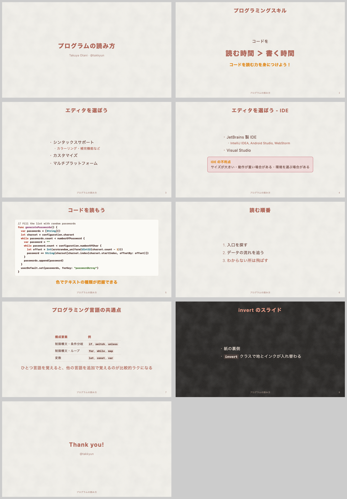
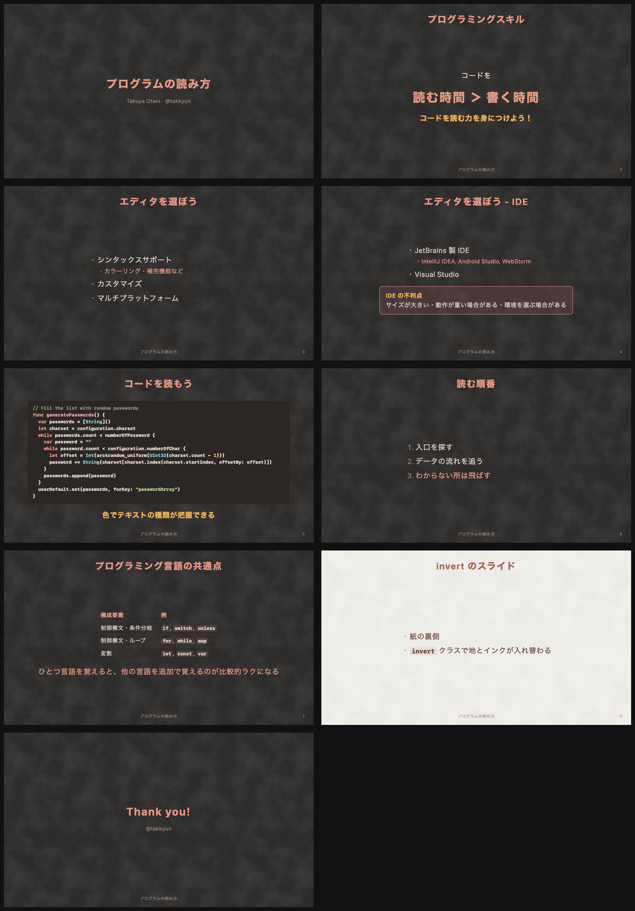

# kinari

> English: [README.md](README.md)

紙をモチーフにした [Marp](https://marp.app/) テーマです。ライト側は**生成りの紙**、
ダーク側は**墨染めの紙**。見出しはテラコッタ、強調はオレンジ、注記は角の丸いピンクの
枠で、フォントは OS 標準のサンセリフを使います。

| ライト | ダーク |
| --- | --- |
|  |  |

## 使い方

[リリース](https://github.com/serendipitynz/marp-theme-kinari/releases)から
`kinari.css` をダウンロードし、デッキで指定します。

```markdown
---
marp: true
theme: kinari
---
```

### Marp CLI

```sh
marp --theme kinari.css slides.md            # HTML
marp --theme kinari.css --pdf slides.md      # PDF
```

毎回コマンドで指定しない場合は `.marprc.yml` に書きます。

```yaml
themeSet:
  - ./kinari.css
```

### Marp for VS Code

ワークスペース設定の `markdown.marp.themes` に、ワークスペースからの相対パスか
URL を追加します。

```json
{
  "markdown.marp.themes": ["./kinari.css"]
}
```

リリースタグを固定した URL も使えます:
`https://raw.githubusercontent.com/serendipitynz/marp-theme-kinari/v0.1.0/kinari.css`

### mallow

[mallow](https://github.com/serendipitynz/mallow) は kinari のリリースを同梱して
いるので、`theme: kinari` と書いたデッキはファイルを置かなくても表示できます。

## ライトとダーク

色はすべて CSS の `light-dark()` の組で書いてあり、スライドは継承した
`color-scheme` に合う側で描かれます。アプリ自身のライト／ダークモードから
`color-scheme` を設定するアプリ（mallow がそうです）では、デッキに何も書かなくても
モードに合わせて描かれます。

Marp CLI と Marp for VS Code は `color-scheme` を設定しないため、ライト側で描かれ
ます。デッキ全体をダーク側で描くには、デッキのどこかに次を書きます。

```markdown
<style>
section { color-scheme: dark; }
</style>
```

これは mallow を含むどのアプリでも側を固定します。

`light-dark()` に対応していないエンジン（Chrome 123 / Safari 17.5 より前）では
ライト側で描かれます。

## クラス

| クラス | 効果 |
| --- | --- |
| `lead` | タイトル用スライド。すべて中央揃えで、サブタイトルは控えめな色になります。 |
| `invert` | スライドがどちらの側でも、紙の反対側で描きます。 |

```markdown
<!-- _class: lead -->

# タイトル

サブタイトル
```

## レイアウト

- スライドの先頭にある `##` 見出しはスライドのタイトルとして上部に置かれ、残りは
  その下の領域で中央に配置されます。
- リストは左揃えのまとまりとしてスライド中央に置かれます。
- `**強調**` はオレンジ、`*em*` は斜体ではなくテラコッタ色です（日本語には斜体が
  ないため）。
- 引用（blockquote）は注記として、角の丸いピンクの枠で描かれます。
- サイズは `16:9`（1280×720、既定）と `4:3`（960×720）です。
- コードは Marp CLI と Marp for VS Code が使う highlight.js の配色に対応しています。

## フォント

kinari はフォントを埋め込みません。OS 標準のサンセリフ（`system-ui`、日本語は
ヒラギノ角ゴ、Noto Sans JP、Yu Gothic UI、メイリオの順）を指定するので、各
プラットフォームで自然な見た目になり、PDF には描画に使われたフォントが入ります。

## 開発

```sh
pnpm check     # リリースが守るルールと、各色のコントラスト
pnpm render    # sample.md を両側の HTML・PDF と 4:3 の PDF で out/ に出力
pnpm preview   # images/preview-*.png を生成（ImageMagick の montage が必要）
```

`render` と `preview` は Marp CLI を `pnpm dlx` で実行するので、何もインストール
しません。

色は `kinari.css` の先頭で `--kinari-light-*` と `--kinari-dark-*` として側ごとに
一度だけ書きます。`pnpm check` は、`@media`・`@supports`・`@container` 以外の
アットルールがあるとき、この 2 つの一覧の外で色を直接書いたとき、スライド・
`invert`・`light-dark()` 非対応エンジン向けのフォールバックの 3 か所が同じ組を
指さなくなったときに失敗します。

## ライセンス

[MIT](LICENSE)
