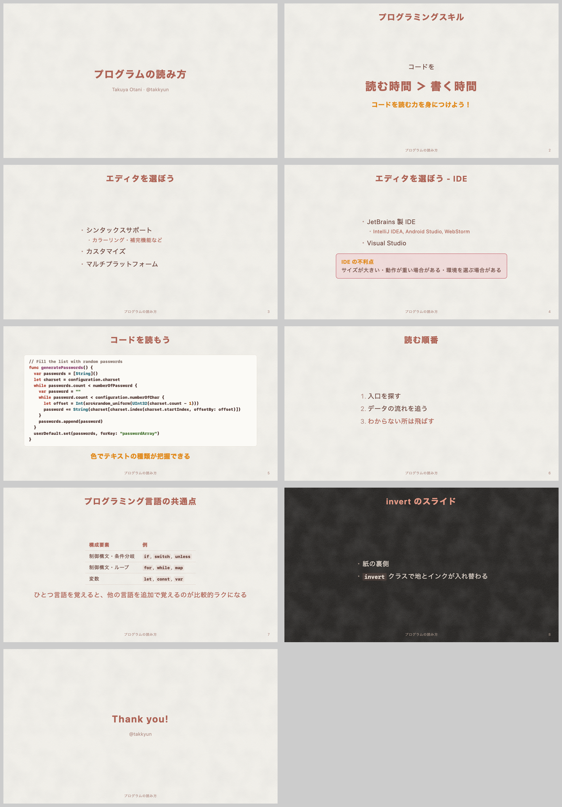
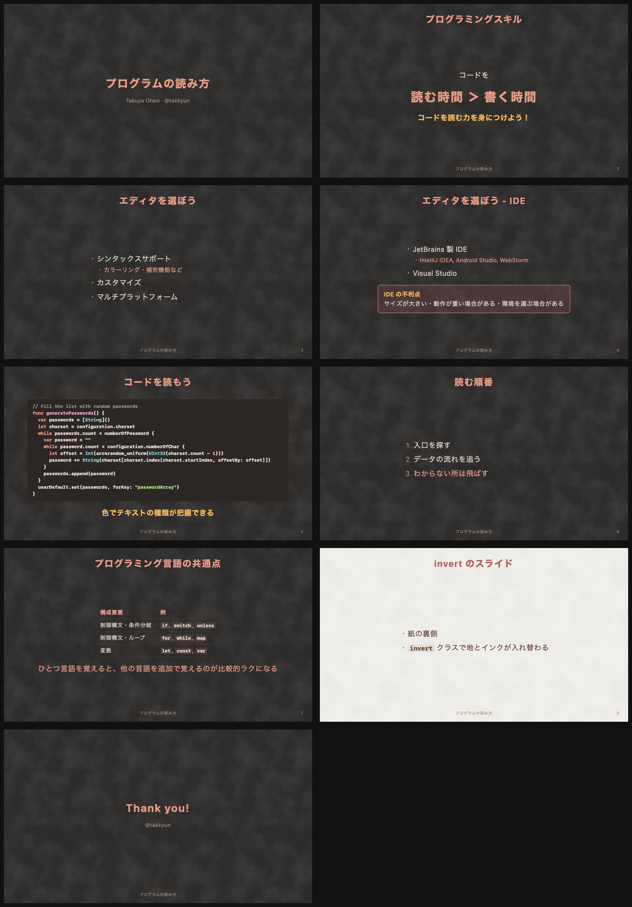

# kinari

> 日本語: [README.ja.md](README.ja.md)

A [Marp](https://marp.app/) theme of paper: **unbleached paper** (kinari) on the
light side and **paper dyed in sumi ink** on the dark side. Terracotta headings,
an orange accent, pink rounded notes, and the system's own sans-serif.

| Light | Dark |
| --- | --- |
|  |  |

## Use

Download `kinari.css` from a [release](https://github.com/serendipitynz/marp-theme-kinari/releases)
and name it in your deck:

```markdown
---
marp: true
theme: kinari
---
```

### Marp CLI

```sh
marp --theme kinari.css slides.md            # HTML
marp --theme kinari.css --pdf slides.md      # PDF
```

To keep the theme out of the command line, put it in `.marprc.yml`:

```yaml
themeSet:
  - ./kinari.css
```

### Marp for VS Code

Add the file — a path relative to the workspace, or a URL — to
`markdown.marp.themes` in the workspace settings:

```json
{
  "markdown.marp.themes": ["./kinari.css"]
}
```

A URL pinned to a release tag works too:
`https://raw.githubusercontent.com/serendipitynz/marp-theme-kinari/v0.1.0/kinari.css`.

### mallow

[mallow](https://github.com/serendipitynz/mallow) bundles a release of kinari,
so a deck naming `theme: kinari` needs no file there.

## Light and dark

Every colour is a CSS `light-dark()` pair, so a slide draws the side that
matches the `color-scheme` it inherits. An app that sets `color-scheme` from
its own light / dark mode — mallow does — draws kinari to match with nothing
written in the deck.

Marp CLI and Marp for VS Code set no `color-scheme`, so a deck draws the light
side there. To draw a whole deck on the dark side, add this anywhere in it:

```markdown
<style>
section { color-scheme: dark; }
</style>
```

That fixes the side in every app, mallow included.

An engine without `light-dark()` (before Chrome 123 / Safari 17.5) draws the
light side.

## Classes

| Class | What it does |
| --- | --- |
| `lead` | A title slide: everything centred, the subtitle muted. |
| `invert` | The other side of the paper, whichever side the slide is on. |

```markdown
<!-- _class: lead -->

# Title

Subtitle
```

## Layout

- A `##` heading that opens a slide is its title: it sits at the top, and the
  rest of the slide is centred in the space below.
- A list is a left-aligned block centred on the slide.
- `**strong**` is the orange accent; `*em*` is terracotta rather than italic,
  since Japanese has no italic.
- A blockquote is a note: a pink panel with a rounded edge.
- Sizes: `16:9` (1280×720, the default) and `4:3` (960×720).
- Code is coloured for highlight.js, which Marp CLI and Marp for VS Code use.

## Fonts

kinari embeds no font. It names the system's sans-serif (`system-ui`, then
Hiragino Sans, Noto Sans JP, Yu Gothic UI and Meiryo for Japanese), so a deck
looks native on each platform and a PDF carries whichever font drew it.

## Development

```sh
pnpm check     # the rules a release holds to, and the contrast of each colour
pnpm render    # HTML and PDF of sample.md on both sides, and a 4:3 PDF, into out/
pnpm preview   # images/preview-*.png (needs ImageMagick's montage)
```

`render` and `preview` run Marp CLI through `pnpm dlx`; nothing is installed.

Every colour is written once per side, as `--kinari-light-*` and
`--kinari-dark-*` at the top of `kinari.css`. `pnpm check` fails when the file
uses an at-rule other than `@media`, `@supports` or `@container`, writes a
colour outside those two lists, or lets the slide, `invert` and the fallback
for engines without `light-dark()` stop pairing the same set.

## License

[MIT](LICENSE)
